# Pulse

Pulse is the frontend for a pet project with real-time chat and voice and video calls. The backend is in a [separate repository](https://github.com/chaliyYehor/Pulse-backend); the deployed frontend is at [pulse.erxxue.dev](https://pulse.erxxue.dev).

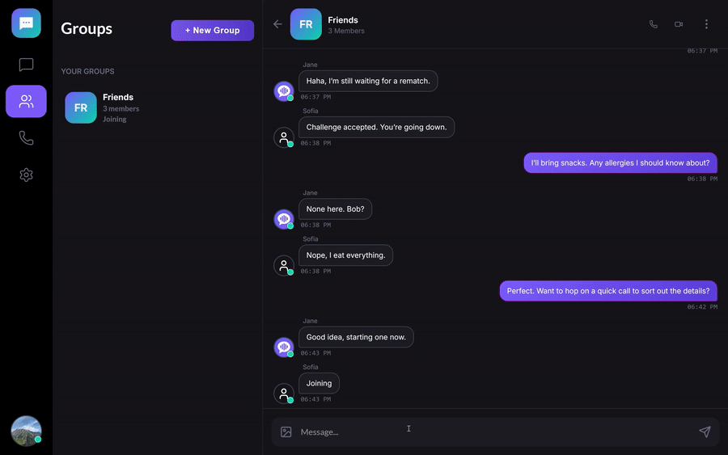

## Features

- Sign in with email and password, GitHub, or Google
- User search, one-to-one chats, and group chats with real-time messages
- Voice and video calls, including group video calls
- Call history
- Profile and preference settings, session management, password change, and account deletion
- Light and dark themes

## Demo

### Messages

<table>
  <tr>
    <td align="center">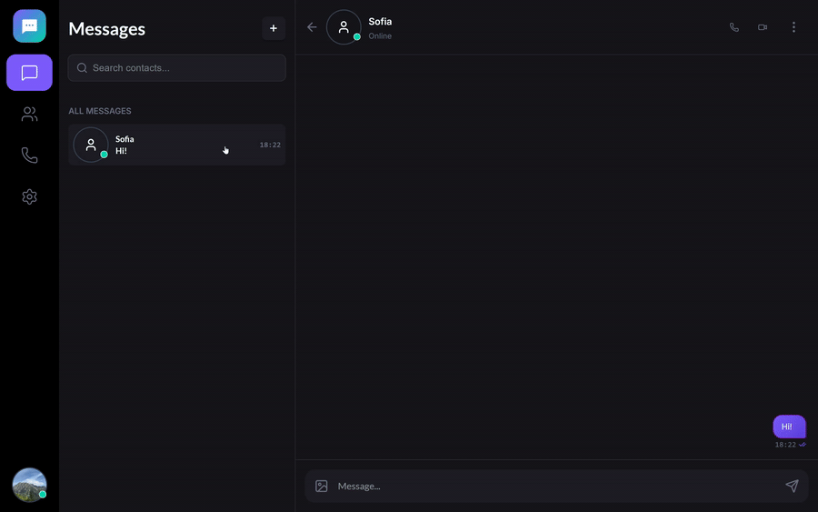<br><sub>Desktop</sub></td>
    <td align="center">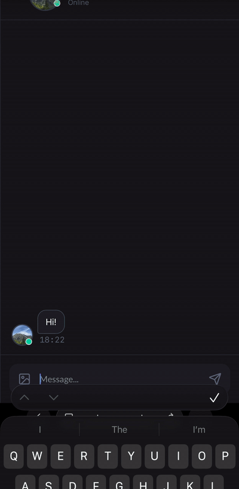<br><sub>Mobile</sub></td>
  </tr>
</table>

### Calls

<table>
  <tr>
    <td align="center">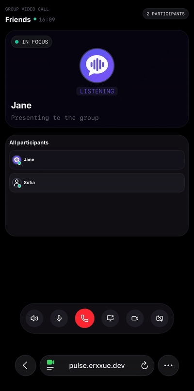<br><sub>Group video call (mobile)</sub></td>
    <td align="center">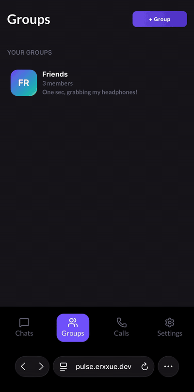<br><sub>One-to-one video call (mobile)</sub></td>
  </tr>
</table>

## Screenshots

| Chat (light theme) | Calls | One-to-one call |
|---|---|---|
| 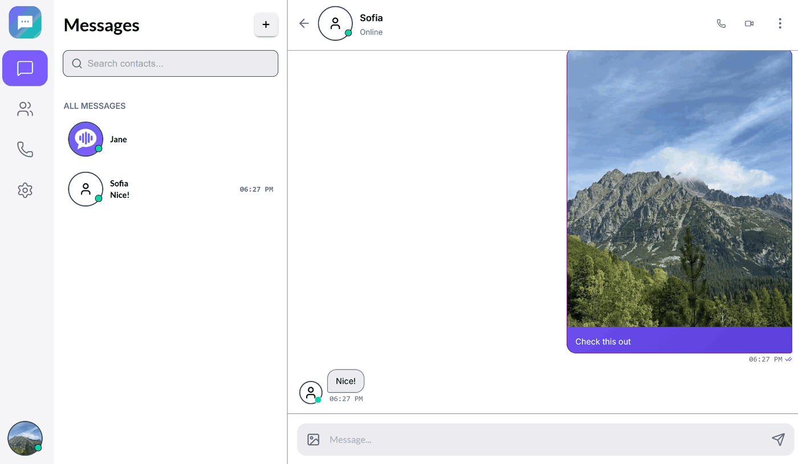 | 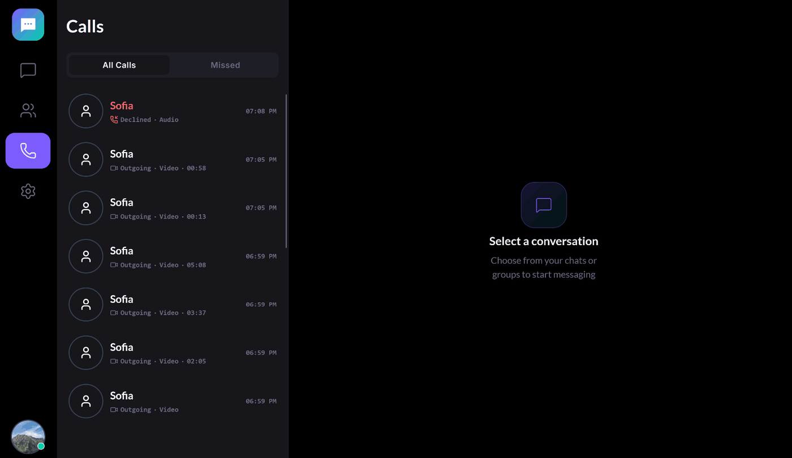 | 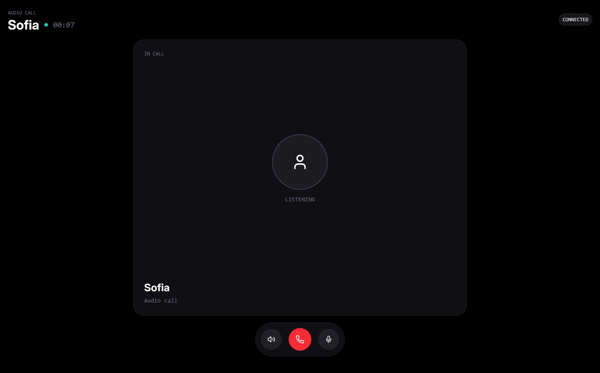 |

| Profile | Edit profile | Security |
|---|---|---|
| 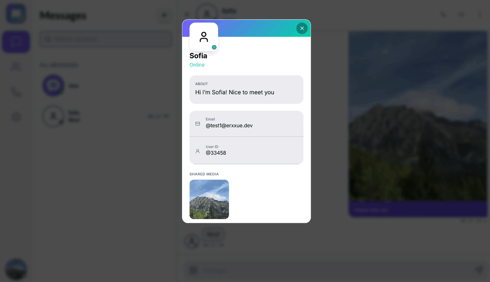 | 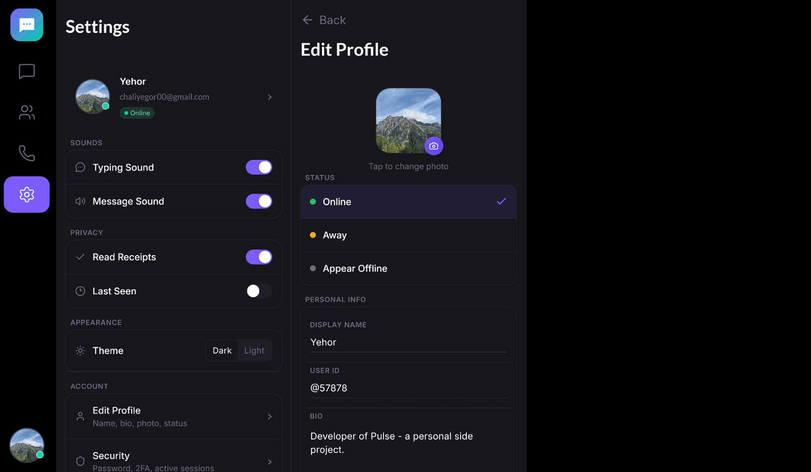 | 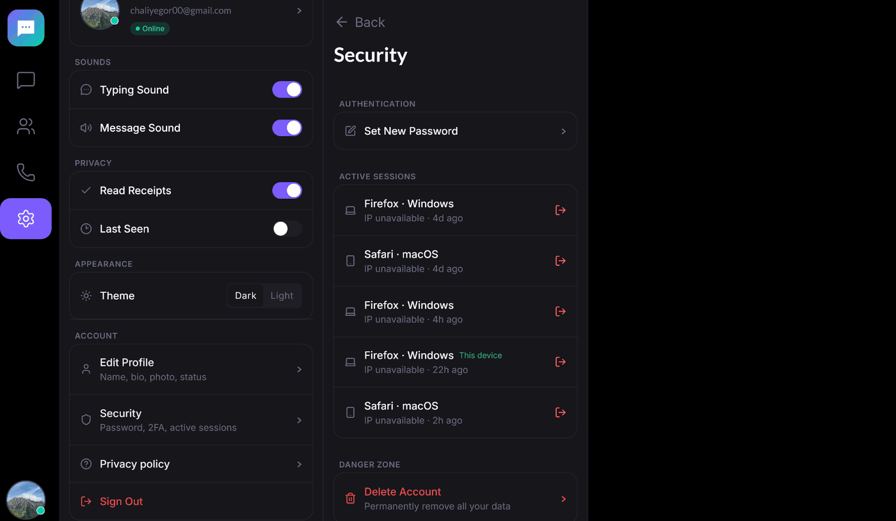 |

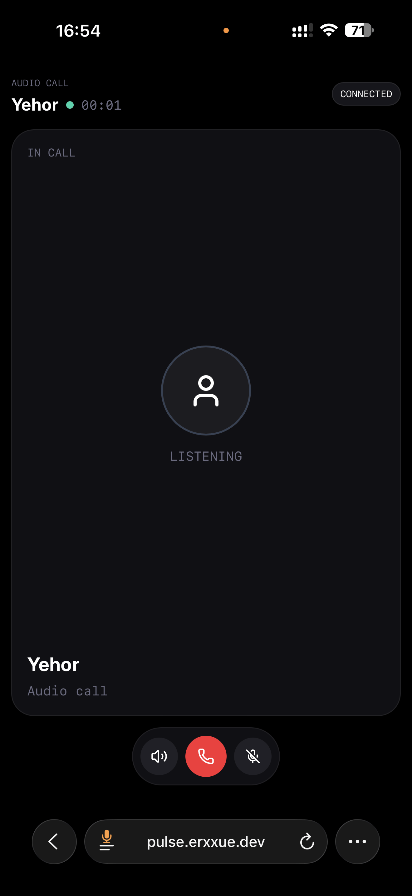

## Demo account

To try the app without signing up, use the shared demo account:

- Email: `demo@erxxue.dev`
- Password: `demodemo`

The account is shared, so anyone can read what is in it and change its data, including the profile picture and name. I am not responsible for that content. The data is cleaned from time to time, so do not store anything private there.

To test chats and calls between two users, sign in with the demo account in one window and with your own account (or a second browser profile) in another. Registering your own account requires a real email address for verification. The backend may take up to a minute to wake up on the first request.

## Stack

React, TypeScript, Vite, React Router, Redux Toolkit, TanStack Query, Socket.IO Client, and LiveKit.

## Requirements

Node.js 20.19+ or 22.12+, and a running instance of the [backend](https://github.com/chaliyYehor/Pulse-backend).

## Setup

```sh
git clone https://github.com/chaliyYehor/Pulse-frontend.git
cd Pulse-frontend
npm install
cp .env.example .env
```

Fill in `.env` with the required service URLs, then run:

```sh
npm run dev
```

## Environment variables

- `VITE_SERVER_URL`: backend base URL for REST requests, authentication, and Socket.IO.
- `VITE_LIVEKIT_URL`: LiveKit server URL used to join calls.

## Scripts

- `npm run dev`: start the Vite development server.
- `npm run build`: run TypeScript project builds and create the production bundle.
- `npm run lint`: run ESLint.
- `npm run preview`: preview the production bundle locally.

## Structure

- `src/api`: REST requests to the backend using Axios.
- `src/components`: shared and page-specific UI components.
- `src/features`: chat event hooks and feature logic.
- `src/hooks`: reusable React hooks.
- `src/lib`: authentication client and utility functions.
- `src/pages`: route page components.
- `src/schemas`: Zod schemas for forms and API data.
- `src/store`: Redux store and slices.
- `src/webRTC`: LiveKit room instance; call pages get credentials through Socket.IO and connect with LiveKit React components.

The app uses REST for HTTP API requests and Socket.IO at `/ws` for realtime events. Voice and video media connections use LiveKit.

## API

The API documentation is served by the [backend repository](https://github.com/chaliyYehor/Pulse-backend) at its `/docs` path.

## Deployment

The frontend is deployed on Vercel. The existing `vercel.json` rewrite sends all paths to `/` for client-side routing.

See the [LICENSE](LICENSE) file.
